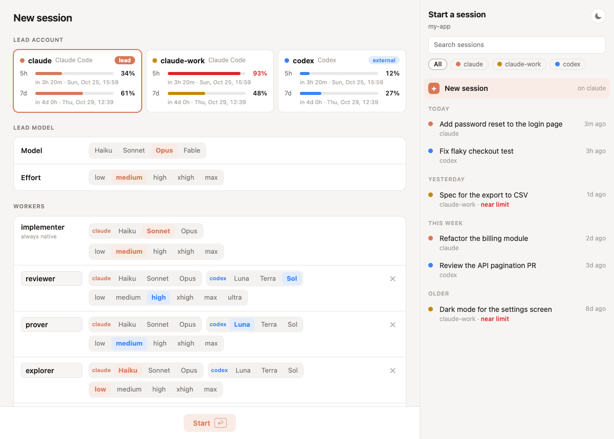

# agents-runner

You pay for more than one coding-agent subscription (say Claude Code on two accounts, plus Codex) and want to spend them well: start each session on the account with quota left, and let another one do the reviews. `fns` is one command that does that from a small window.



*Placeholder data.*

## What you do

Run `fns` in a repo. The window shows:

- **Lead account**: every Claude Code and Codex account you are logged into, with its 5-hour and weekly quota (read without spending tokens). Click the one that runs the session, then pick its model and effort.
- **Workers**: who runs each subagent the skills spawn. For each role (`implementer`, `reviewer`, `explorer`, or one you add), either the session's own subagents (native) or a one-shot run on the other CLI (external), with its model and effort. `implementer` is always native: the session works with it, and roles not listed fall back to it.
- **Recent sessions** of that folder, from every account: click one to resume it, keeping its workers or changing them.

Press Start (or Enter): the window closes and the session starts in your terminal with that worker table. Each account keeps its own table per repo, so next time it is already set. The window opens on `claude` (on `codex` without a Claude login), with the last model and effort you picked in that repo.

In a hurry: type an account name as soon as the window opens (`work` for `claude-work`) and press Enter. A new session starts there with its saved table.

Sessions started the usual way (`claude`, `codex`) are untouched: every worker is native, as before.

## Install

Needs `python3` and `claude`, `codex` or both; with one CLI only, every worker runs native. On macOS the window is built on first use with `swiftc`; without it the page opens in the browser.

```sh
git clone https://github.com/gianmadd/agents-runner ~/.agents-runner
echo 'source ~/.agents-runner/fns.sh' >> ~/.zshrc   # or ~/.bashrc
```

Open a new terminal, then run `fns` in any repo. To update: `git -C ~/.agents-runner pull`.

Accounts come from your shell rc file: each CLI's default login, plus every alias that sets `CLAUDE_CONFIG_DIR` or `CODEX_HOME` and has a login, e.g. `alias claude-work='CLAUDE_CONFIG_DIR=~/.claude-work claude'`.

[agents-repo-setup](https://github.com/gianmadd/agents-repo-setup) offers this install.

## Good to know

- **External workers run with permissions bypassed** and return only a report, in `.scratch/workers/`. Use them for roles that only read or work in a throwaway copy: reviewer, explorer.
- **With a plugin that runs Codex as subagents** installed and enabled in a Claude account, a session led from it runs external workers as `codex:<family>` subagents instead: in Codex's sandbox (read-only for the roles that report), in the task list, and open to follow-ups. There the implementer may run on Codex too: it writes only in its working folder, reaches the network (databases, APIs), and Codex's own reviewer, not you, decides anything more. The plugin uses Codex's default login, whatever account the page picks; where it does not answer, the session falls back to the run above, and to a native implementer.
- **The table goes into that session only**, as extra instructions. Skills that spawn workers, like `implement-loop` in [gianmadd/agentic-dev-kit](https://github.com/gianmadd/agentic-dev-kit), follow it; the text explains itself, so they need nothing else from here.
- **What is saved**: the last choice per repo, in `.git/agents-workers.json`: never committed, shared by the repo's worktrees.
- **Quota readings** come from the text of `claude -p /usage` (undocumented) and from `codex app-server` (experimental). A CLI update can break them; the card then shows "n/a".

Why it works this way: [ADR 0001](docs/adr/0001-workers-chosen-per-session.md).

## Files

- [`fns.sh`](fns.sh): the `fns` shell function, sourced from the rc file
- [`src/workers.py`](src/workers.py): the one-shot local server: accounts, quotas, recent sessions, saved tables, and the launch
- [`src/page.html`](src/page.html): the page
- [`src/window.swift`](src/window.swift): the native window around the page
- [`tests/`](tests/): `python3 -m unittest discover tests`
- [`docs/adr/`](docs/adr/): why it works this way
- [`GLOSSARY.md`](GLOSSARY.md): project vocabulary
